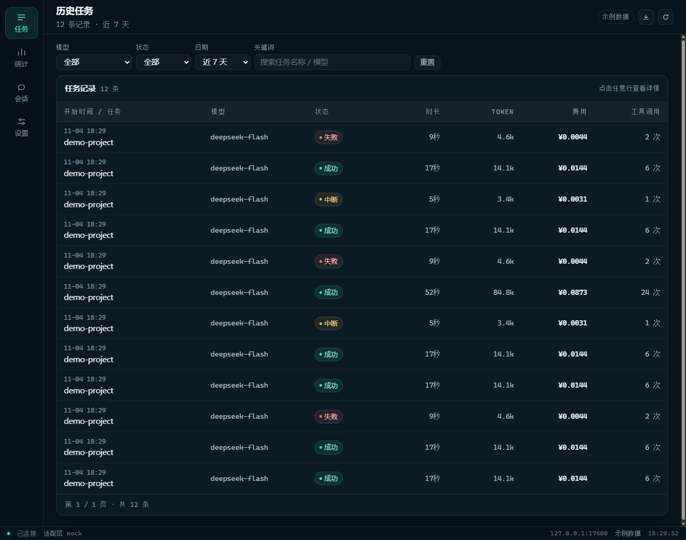
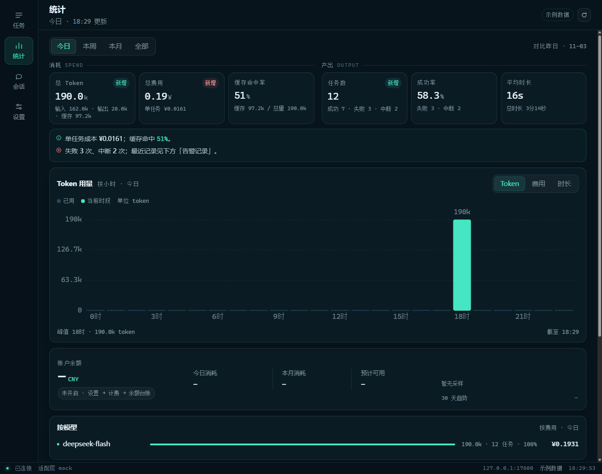
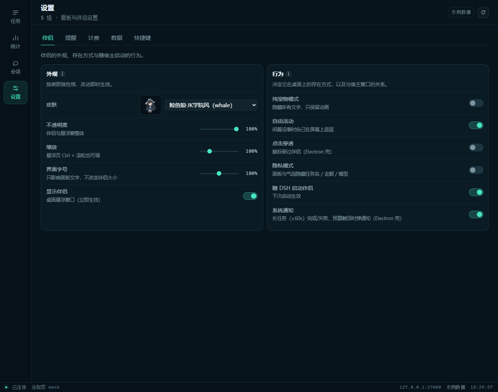
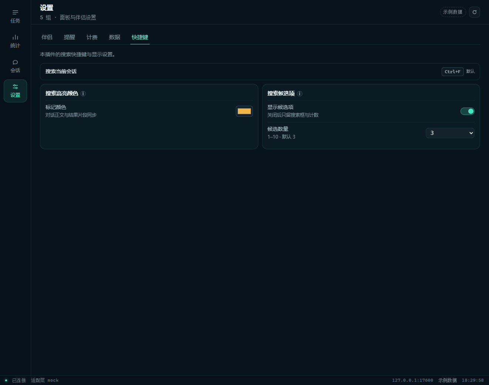
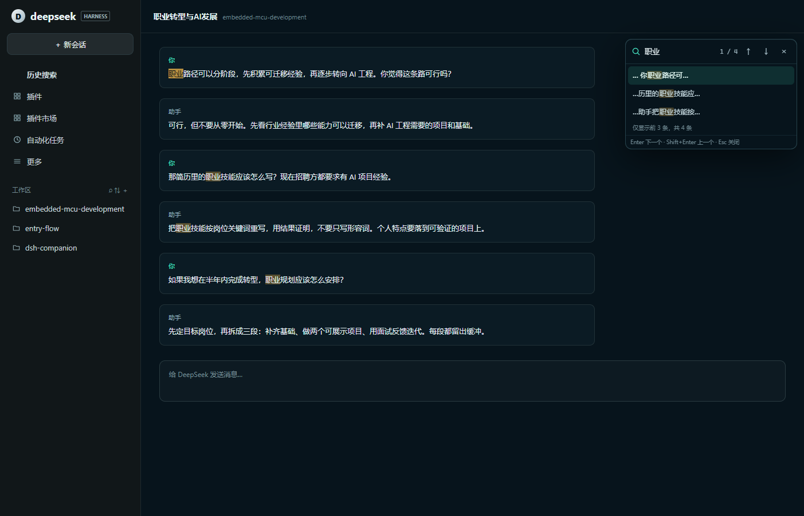
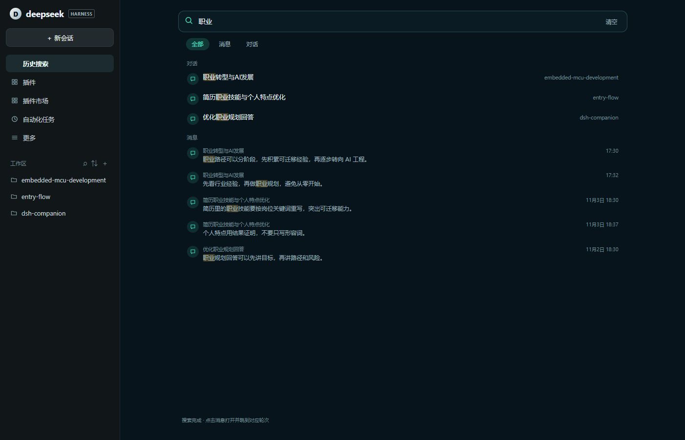

<div align="center">


# DSH Companion 2.1

A companion plugin for [DeepSeek Harness](https://github.com/deepseek-ai/deepseek-harness)

Desktop pet · live status · usage stats · history search · budget/balance · session management

[中文](README.md) · [Install](#install) · [Features](#features) · [Screenshots](#screenshots) · [Development](#development)


</div>

<p align="center">
  
</p>

## What's new in 2.1

- **History search**: a new **History search** entry in the left sidebar (above Plugins) with All / Messages / Conversations sections across every saved session.
- **No result cap**: messages are scanned across all workspace sessions in batches, with results rendered progressively.
- **Jump back to the content**: clicking a message opens its session, jumps to the matching turn, and highlights the search term in the transcript with the same Highlight API as Ctrl+F.
- **One highlight color**: transcript hits and snippet marks share the companion panel's **Search highlight color** with current-conversation search.
- **Idle-friendly**: opening the page does not prewarm or touch disk; scanning only starts after you type, in cursor batches with 2 concurrent reads.

## Features

| Area | Capability |
| --- | --- |
| **Desktop pet** | Start / thinking / output / wrap-up / done / failure animations; status bubbles; petting, dragging, idle roaming and sitting reminders |
| **5 skins** | Whale girl JK, secretary, police, hanfu and qipao — each with its own expressions, motions and voice |
| **Bottom-left badge** | Current task, today's tokens, running state, balance and peak/off-peak; click to open the full panel |
| **History search** | Sidebar entry; All / Messages / Conversations; full-session progressive scan; click to open, jump to the turn and highlight the transcript |
| **Current conversation search** | Ctrl+F or the header button; searches loaded messages; 1–10 candidates (default 3, can be hidden); click to jump and highlight |
| **Shared highlight color** | Settings → Shortcuts → Search highlight color; current search, history snippets and transcript hits use the same color |
| **Stats panel** | Tokens, cost, cache hits, success rate, duration, charts, model/project rankings and alert log |
| **Reasoning level** | Switch thinking effort from the composer via the sonar bar |
| **Peak hours & holidays** | Official Beijing-time rule: weekdays 09:00–12:00 / 14:00–18:00 peak; weekends and statutory holidays off-peak; holiday-calendar sync |
| **Budget & balance** | Per-task and daily budget alerts; DeepSeek account balance sampling and low-balance reminders |
| **Session management** | Permanently delete sessions (the host only archives); bulk delete |
| **Data retention** | Keep everything by default; optionally keep only the last N months; preview and confirm before cleanup |
| **Desktop experience** | Transparent always-on-top window, click-through, real tray, system notifications, privacy mode and pure-pet mode |

## Screenshots

> Screenshots use the plugin's mock demo data — no real conversations or account data.

### Desktop pet and live status

<p align="center">
  
</p>

The pet switches animations and bubbles with the task state; the bottom-left badge shows the current task, tokens, balance and peak/off-peak.

### Stats panel

| Tasks | Usage |
| --- | --- |
|  |  |

The Tasks page supports model/status/date/keyword filters, a task detail drawer and pagination. Stats include token/cost/duration trends, cache hits, success rate, balance trend, model/project rankings and alerts.

### Settings

| Companion & behavior | Search & shortcuts |
| --- | --- |
|  |  |

## Search

### Current conversation

Press **Ctrl+F** or click the search button in the conversation header. It searches the **loaded** messages of the current session, highlights immediately, shows only 3 characters around each hit, and supports Enter / Shift+Enter / ↑↓ navigation.



### History

Open **History search** in the left sidebar (above Plugins):

- **All** shows both session-title matches and message hits
- **Messages** lists matching messages with session, snippet and time
- **Conversations** lists sessions whose titles match
- Messages are scanned in batches and rendered as they arrive; no result or session cap
- Clicking a message opens the session, jumps to the matching turn and highlights the search term in the transcript
- The page does not prewarm or read from disk until you type



### Highlight color

Companion panel → Settings → Shortcuts → **Search highlight color → Marker color**. It applies to:

- current-conversation transcript highlights
- history-search transcript highlights
- keyword marks in both result lists

The default is `#f0b64a`, stored on the current DSH device.

## Install

### Requirements

- DeepSeek Harness **0.2.x**
- Node.js **22.19+** or **24+**
- Windows / macOS / Linux (the tray and transparent floating window are best under Electron)

### Plugin manager (recommended)

DSH → Plugin Manager → Install plugin → enter:

```text
@qiuzhiyei/dsh-companion
```

Then **enable** the plugin and **fully quit and relaunch DSH**.

### CLI (npm)

```sh
dsh plugin --profile desktop add @qiuzhiyei/dsh-companion
```

Replace `desktop` with your profile name. Enable it in the plugin manager, then fully restart DSH.

### GitHub (dist is committed)

```sh
dsh plugin --profile desktop add github:qiuzhiyei/dsh-companion
```

The repository ships `dist/`, so no build is required at install time. Enable the plugin and fully restart DSH.

### Upgrade

```sh
dsh plugin --profile desktop add @qiuzhiyei/dsh-companion@latest
```

Then fully restart DSH. Settings and usage data stay on the local machine.

> The pet downloads its Electron runtime on first launch (~150 MB, with mirrors). If the download fails, the panel, stats and search still work; the companion falls back to browser mode.

## Usage

- **Badge**: current task, today's tokens, running state, balance and peak/off-peak; click for the full panel.
- **Pet**: left-click to pet, drag to move, double-click for balance, Ctrl + wheel to resize; it roams when idle.
- **Panel**: Tasks / Stats / Sessions / Settings; click a task row for details. Settings has five groups: Companion / Reminders / Billing / Data / Shortcuts.
- **Search**: Ctrl+F for the current conversation; the sidebar **History search** for all sessions.
- **Reasoning level**: click the current effort next to the model name, then drag the sonar bar.
- **Privacy**: privacy mode hides task names, models and amounts; pure-pet mode keeps only the animation.

## Data & privacy

- Tasks, settings and balance snapshots live locally in `~/.dsh/dsh-companion`.
- No conversation text is stored — only task metadata (project, model, tokens, cost, tool counts).
- History search reads DSH session logs locally; search content is never uploaded.
- Every HTTP service listens on loopback only.

## Development

```sh
pnpm install
pnpm run build
pnpm test
```

- Architecture, slots, pitfalls and design decisions: [AGENTS.md](https://github.com/qiuzhiyei/dsh-companion/blob/main/AGENTS.md).
- Tests: `node --test`, currently **149**.
- `dist/` is committed; always run `pnpm run build` before publishing.
- Demo: `node demo.mjs` (mock loop, no DSH needed).

## License

[MIT](LICENSE) © 2026 QiuWenXiong
