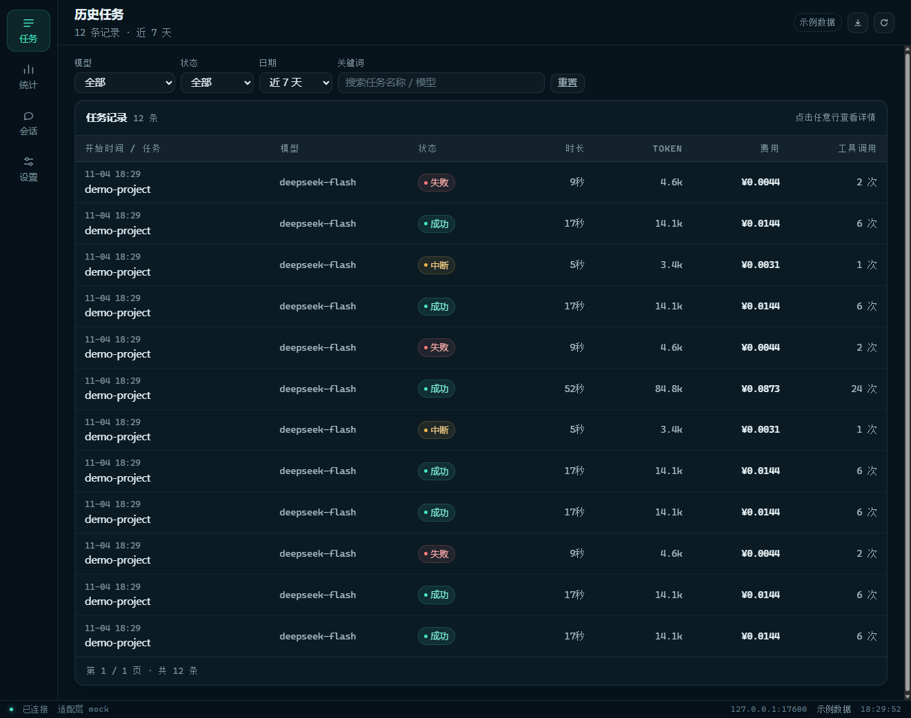
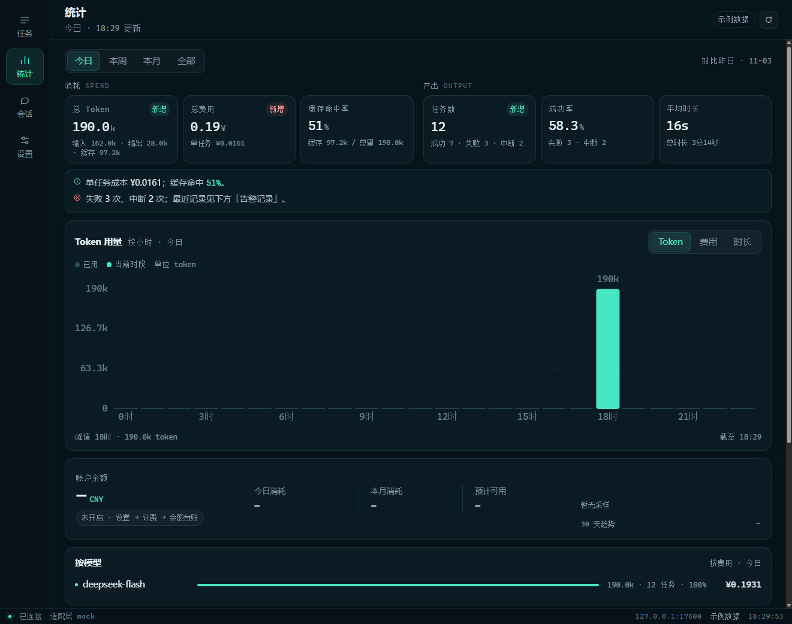
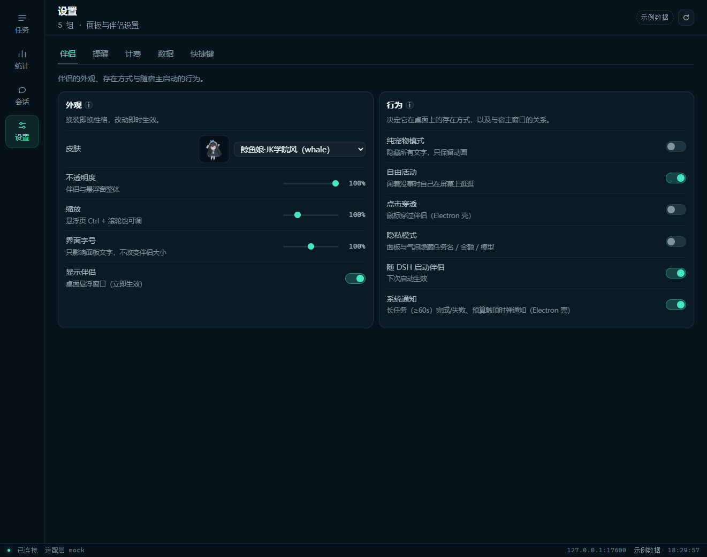
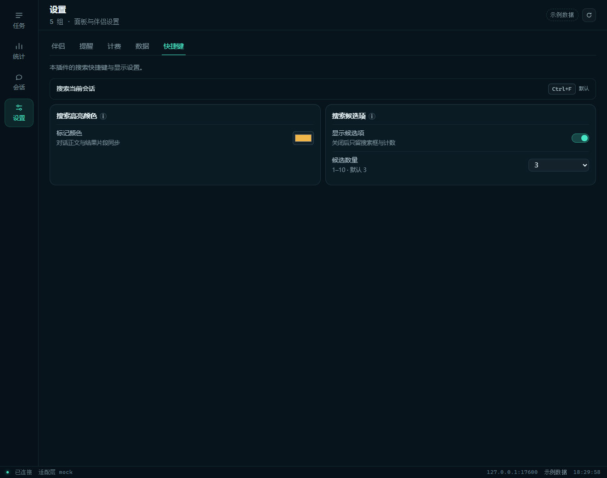
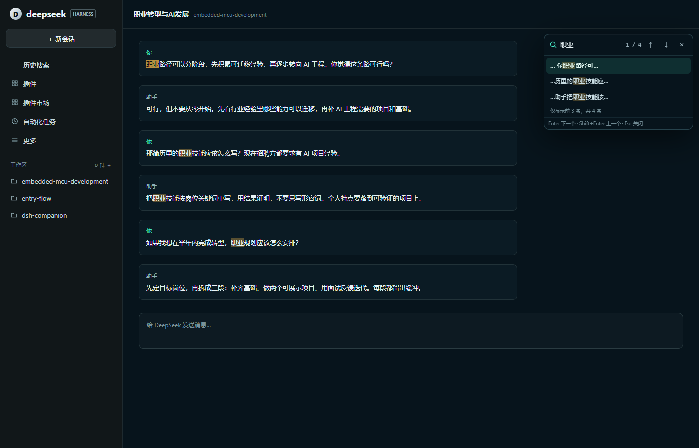
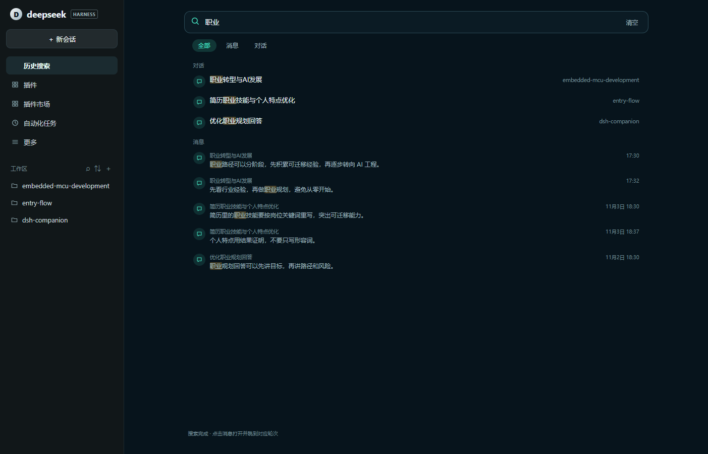

<div align="center">


# DSH 伴侣 2.1

给 [DeepSeek Harness](https://github.com/deepseek-ai/deepseek-harness) 的伴侣插件

桌宠 · 实时状态 · 用量统计 · 历史对话搜索 · 预算/余额 · 会话管理

[English](README.en.md) · [安装](#安装) · [功能](#功能) · [截图](#截图) · [开发](#开发)


</div>

<p align="center">
  
</p>

## 本次更新 · 2.1

- **历史对话搜索**：左侧栏新增「历史搜索」入口（在「插件」上方），按「全部 / 消息 / 对话」搜索所有历史会话。
- **不设结果上限**：消息按批扫描全部有工作区的会话，结果渐进显示；不是只搜最近几条。
- **点击直接回到内容**：点消息打开对应会话、跳到命中轮次，并在对话正文里用和 Ctrl+F 相同的 Highlight API 标亮搜索词。
- **一套高亮颜色**：历史搜索的结果片段和正文命中，与当前会话搜索共用伴侣面板里的「搜索高亮颜色」；改色两边同步。
- **平时不占资源**：打开搜索页不预热、不读盘；只有实际输入后才按游标分批扫描，2 并发，不设时间截断。

## 功能

| 模块 | 能力 |
| --- | --- |
| **桌宠** | 开始 / 思考 / 输出 / 收尾 / 完成 / 失败动画；任务状态气泡；摸头、拖拽、自由活动、久坐提醒 |
| **5 套皮肤** | 鲸鱼娘 JK / 秘书 OL / 女警 / 中华娘 / 旗袍；每套有独立表情、动作和台词口吻 |
| **左下角角标** | 当前任务、今日 Token、运行状态、余额、高峰/闲时；点击打开完整面板 |
| **历史搜索** | 左侧栏入口；全部 / 消息 / 对话分组；全量会话渐进扫描；点消息打开会话、跳轮次、正文高亮 |
| **当前会话搜索** | Ctrl+F 或标题栏按钮；搜索已加载的消息；候选 1–10 个（默认 3，可关闭）；点击跳转并高亮 |
| **共享高亮颜色** | 面板「设置 → 快捷键 → 搜索高亮颜色」；当前搜索、历史搜索结果片段和正文命中同色 |
| **统计面板** | Token、费用、缓存命中、成功率、时长、趋势图、模型/项目排行、告警记录 |
| **推理等级** | 输入栏模型名旁直接切换思考档位（声呐能量条） |
| **峰谷与节假日** | 官方北京时间规则：工作日 9:00–12:00 / 14:00–18:00 高峰；周末与法定节假日闲时；支持同步节假日日历 |
| **预算与余额** | 单任务 / 每日预算告警；DeepSeek 账号余额采样与低余额提醒 |
| **会话管理** | 彻底删除会话（不可恢复）；批量删除；宿主只提供归档 |
| **数据保留** | 默认永久保留；可设置只保留最近 N 个月；清理前有预览与确认 |
| **桌面体验** | 透明置顶悬浮窗、点击穿透、真托盘、系统通知、隐私模式、纯宠物模式 |

## 截图

> 截图使用插件自带的 mock 演示数据，不包含任何真实对话或账号信息。

### 桌宠与实时状态

<p align="center">
  
</p>

桌宠会跟着任务状态切换动作和气泡；左下角角标同时显示任务、Token、余额和峰谷。

### 统计面板

| 任务记录 | 用量统计 |
| --- | --- |
|  |  |

任务页支持模型/状态/日期/关键词筛选、任务详情抽屉和分页；统计页有 Token/费用/时长趋势、缓存命中、成功率、余额趋势、模型/项目排行和告警记录。

### 设置

| 伴侣与行为 | 搜索与快捷键 |
| --- | --- |
|  |  |

## 搜索

### 当前会话搜索

按 **Ctrl+F** 或点对话标题栏的搜索按钮。搜索范围是当前会话**已加载**的消息，输入后即时高亮；结果片段只保留命中前后各 3 个字符，Enter / Shift+Enter / ↑↓ 在命中之间跳转。



### 历史对话搜索

打开左侧栏「历史搜索」（在「插件」上方）：

- 「全部」同时显示会话标题命中与消息命中
- 「消息」列出所有命中消息，显示所属会话、片段和时间
- 「对话」只显示标题命中的会话
- 消息分批扫描，结果边搜边出；不设结果数量/会话数量上限
- 点击消息后打开会话、跳到命中轮次，并在正文里高亮搜索词
- 搜索页打开时不预热；输入后才读盘



### 高亮颜色

伴侣面板 → 设置 → 快捷键 → **搜索高亮颜色 → 标记颜色**。这个颜色同时作用于：

- 当前会话搜索的正文高亮
- 历史搜索的正文高亮
- 两边结果片段里的关键词标记

默认 `#f0b64a`，保存在当前 DSH 设备。

## 安装

### 环境

- DeepSeek Harness **0.2.x**
- Node.js **22.19+** 或 **24+**
- Windows / macOS / Linux（桌面壳的托盘和透明悬浮窗在 Electron 下体验最好）

### 方式一：插件管理器（推荐）

DSH → 插件管理器 → 安装插件 → 输入：

```text
@qiuzhiyei/dsh-companion
```

安装后**启用**插件，再**完全退出并重开 DSH**。

### 方式二：命令行（npm）

```sh
dsh plugin --profile desktop add @qiuzhiyei/dsh-companion
```

把 `desktop` 换成你的 profile 名。装完同样在插件管理器里启用，然后完全重启 DSH。

### 方式三：GitHub（仓库自带 dist）

```sh
dsh plugin --profile desktop add github:qiuzhiyei/dsh-companion
```

仓库已提交构建产物 `dist/`，不需要在安装时构建。装完启用并完全重启 DSH。

### 升级

```sh
dsh plugin --profile desktop add @qiuzhiyei/dsh-companion@latest
```

升级后完全重启 DSH。设置和统计数据保存在本机，不会因升级丢失。

> 桌宠首次启动会自动下载 Electron 运行时（约 150 MB，带国内镜像）。下载失败不影响面板、统计和搜索；伴侣会先以浏览器模式运行。

## 使用

- **角标**：看当前任务、今日 Token、运行状态、余额和峰谷；点击打开面板。
- **桌宠**：左键摸头、拖拽移动、双击看余额、Ctrl + 滚轮缩放；空闲时会自己在屏幕上逛。
- **面板**：任务 / 统计 / 会话 / 设置；点任务行打开详情，设置分伴侣 / 提醒 / 计费 / 数据 / 快捷键五组。
- **搜索**：Ctrl+F 搜当前会话；左侧栏「历史搜索」搜全部历史。
- **推理等级**：点输入栏模型名旁的当前档位，拖动声呐条切换思考强度。
- **隐私**：隐私模式隐藏任务名、模型和金额；纯宠物模式只保留动画。

## 数据与隐私

- 任务、设置、余额快照只保存在本机 `~/.dsh/dsh-companion`。
- 不保存对话正文，只记录任务级元数据（项目、模型、Token、费用、工具计数）。
- 历史搜索只在本机读取 DSH 会话日志；搜索内容不会上传。
- 所有 HTTP 服务只监听回环地址。

## 开发

```sh
pnpm install
pnpm run build
pnpm test
```

- 双半边架构、槽位、坑位和设计决策见 [AGENTS.md](https://github.com/qiuzhiyei/dsh-companion/blob/main/AGENTS.md)。
- 测试：`node --test`，当前 **149** 项。
- 构建产物 `dist/` 纳入版本库；发布前务必先 `pnpm run build`。
- 演示：`node demo.mjs`（mock 自动循环，不需要 DSH）。

## License

[MIT](LICENSE) © 2026 QiuWenXiong
