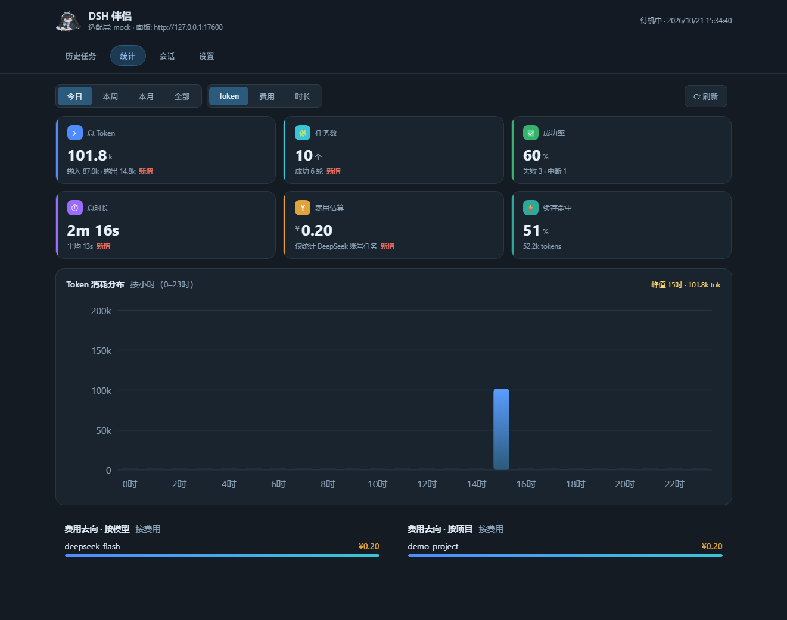
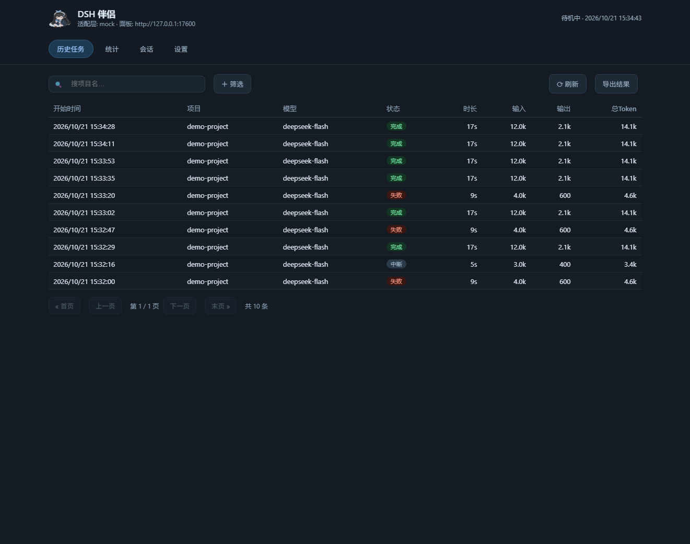
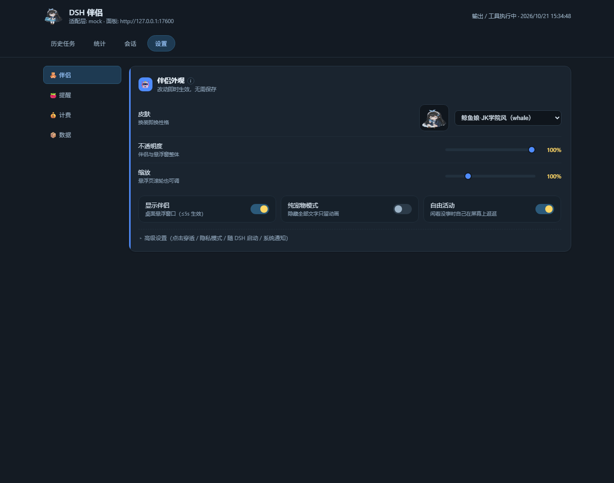

<div align="center">

# 🐳 DSH 伴侣 · dsh-companion

**给 [DeepSeek Harness](https://github.com/deepseek-ai/deepseek-harness) 的伴飞插件**
桌宠陪伴 · 用量与费用统计 · 预算告警 · 界面增强

[English](README.en.md) · [快速开始](#快速开始) · [功能](#功能一览) · [配置](#配置) · [自制皮肤](#自制皮肤) · [开发](#开发)


</div>

---

DeepSeek Harness（`dsh`）是「一切皆插件」的 agent harness，但跑长任务时你通常不知道
它在忙什么、花了多少、要不要歇一会儿。**DSH 伴侣**把这三件事一起解决：一只跟着任务
状态变化表情的桌宠、一套看得懂的用量/费用面板、以及到点就提醒你起来走走的久坐闹钟。

全部数据留在本机（`node:sqlite` 或 JSON），只监听 `127.0.0.1`，不联网上报任何东西
（唯一的出网请求是拉 DeepSeek 官方定价页）。

<table>
<tr>
<td width="50%"></td>
<td width="50%"></td>
</tr>
<tr>
<td align="center"><sub>统计：KPI 环比 · 趋势图 · 费用去向</sub></td>
<td align="center"><sub>历史：筛选芯片 · 分页 · 按筛选导出</sub></td>
</tr>
</table>

## 功能一览

| 能力 | 说明 |
| --- | --- |
| 🐳 **桌宠** | 浏览器 / 桌面悬浮窗里的一只鲸鱼娘，随 DSH 任务状态换表情：待机 → 启动 → 思考 → 卖力（流式输出/工具执行）→ 收尾 → 完成 / 出错 / 中断 |
| 👗 **5 套皮肤 = 5 种人格** | `whale`（JK 学院风，默认）/ `whale-ol`（秘书）/ `whale-police`（女警）/ `whale-hanfu`（中华娘）/ `whale-qipao`（旗袍）。换装不是换张贴图——表情帧、互动反应帧、台词口吻整套都跟着换 |
| 💬 **互动** | 左键抚摸出爱心粒子 + 台词、连点 5 下有晕头彩蛋、拖着走时被拎起、落地生气；闲下来会自己张望/伸懒腰/打瞌睡，还会**自己在屏幕上慢慢逛一圈**，被打断立刻回原位 |
| 🖱 **Ctrl + 滚轮调大小** | 按住 **Ctrl** 再滚滚轮才缩放（40%–300%，每格 8%），不用开面板；平时滚动文档/网页经过她**不会**误改大小。和「设置 → 伴侣 → 缩放」滑杆是同一个值，改完立刻存盘 |
| ⏰ **久坐提醒** | 坐够 N 分钟（默认 60，5–480 可调）就伸懒腰提醒，气泡里「起来走走 / 稍后 10 分钟」；人离开电脑 ≥3 分钟自动重算，读代码时 DSH 空闲也照样算坐着 |
| 📊 **统计面板** | 6 张 KPI 卡（Token / 任务数 / 成功率 / 时长 / 费用 / 缓存命中）**每张带环比**；Token·费用·时长三指标切换的柱状图；**费用去向排行**（按模型 / 按项目） |
| 💰 **费用估算** | 拉取 DeepSeek 官方定价，**高峰 / 闲时（5 折）分档**计价、缓存命中单独按 1/50 价、按任务开始时刻定档；只统计 DeepSeek 账号 / API key 的任务，自建渠道 Token 照记、费用恒 0 |
| 🚨 **预算告警** | 单任务 / 每日 × Token / 费用四档上限，触顶时桌宠气泡 + 系统通知 + `companion/budget-alert` 事件；设置页有今日用量进度条 |
| 🗂 **历史与导出** | 服务端筛任务（模型 / 状态 / 日期 / 关键词），CSV / JSON 导出（带 BOM，Excel 友好），可按当前筛选导出 |
| 🧹 **会话管理** | 补上宿主没有的「彻底删除会话」：GUI 会话行菜单单项删除 + 面板批量删除，删除前跑安全检查（运行中会话拒删） |
| 🖥 **桌面壳（可选）** | 装个 Electron 就得到真托盘 + 透明无边框置顶悬浮窗 + 点击穿透（宠物本体才接鼠标，周边透明区直接点到桌面）+ 位置记忆 |
| 🔔 **系统通知** | 长任务（≥60s）完成/失败、预算触顶才弹，短任务不打扰；可在设置页关掉 |
| 🧩 **零依赖前端** | 面板与悬浮页都是服务端生成的单文件 HTML（无构建、无 CDN、无外部字体），离线可用；图表是手绘 SVG |

## 快速开始

**前置**：Node.js `^22.19.0 || >=24.0.0`、[DeepSeek Harness](https://github.com/deepseek-ai/deepseek-harness)（目前 0.2.0-rc 线）、pnpm。

```sh
# 1. 拿到代码（也可以直接 git clone 到任意位置）
git clone https://github.com/qiuzhiyei/dsh-companion.git dsh-companion
cd dsh-companion

# 2. 装依赖 —— 装完自动编译 dist/（仓库不含构建产物，靠 prepare 钩子现编）
pnpm install

# 3. 装进你的 DSH profile（路径相对「调用目录」，所以在插件的父目录执行）
cd ..
dsh plugin --profile <你的 profile> add ./dsh-companion

# 4. 启动 DSH，日志里会打印伴侣地址
dsh --profile <你的 profile>
```

> `pnpm install` 会跑 `prepare`（`scripts/prepare.mjs`），把 node 半边和浏览器半边两份 tsconfig 都编译好，
> 所以**不用再手动 `pnpm run build`**；改完源码想重建时再单独跑一次即可。
>
> 别图省事用 `dsh plugin add github:qiuzhiyei/dsh-companion`：pnpm 10+ 默认禁止 git 依赖执行构建脚本
> （`ERR_PNPM_GIT_DEP_PREPARE_NOT_ALLOWED`），而本仓库不含 `dist/`、必须现场编，正好被这条规则卡住。

跑起来后会看到：

- **侧边栏角标**：GUI 底部一行 `今日 30.98M token`，点它直接在当前窗口弹出完整面板
- **伴侣页**：`http://127.0.0.1:17573`（悬浮窗；端口被占会自动 +1，最多试 10 个）
- **面板页**：`http://127.0.0.1:17573/panel`

> 想让桌宠真的浮在桌面上（透明、置顶、点击穿透），再装一下可选壳：
> `pnpm add -D electron`，然后什么都不用做——`server.shell: 'auto'` 会在插件启动时自动拉起它。

### 不想装 DSH，先看看它长什么样

```sh
node demo.mjs        # mock 事件自动循环，数据写临时目录，Ctrl+C 干净退出
node demo.mjs fast   # 20 倍速，30 秒看完一整套状态
```

然后打开 `http://127.0.0.1:17573`。不需要 API Key，也不需要 DSH。

## 配置

插件配置走 cordis 的 schemastery，写在 profile 的 `cordis.patch.yml` 里；**日常用的开关都在面板「设置」页**（改一个存一个，即时生效，没有保存按钮）。

| 键 | 默认 | 说明 |
| --- | --- | --- |
| `adapter` | `'auto'` | `auto` 接 DSH 真实事件；`mock` 用内置模拟器 |
| `dataDir` | `''` | 数据目录；空 = `$DSH_HOME/dsh-companion`，无 `DSH_HOME` 时 `~/.dsh/dsh-companion` |
| `storage` | `'auto'` | `auto`（SQLite 优先，失败降级 JSON）/ `sqlite` / `json` |
| `currency` | `'CNY'` | 费用货币 |
| `settleMs` | `8000` | 任务结束后表情停留时长 |
| `logEvents` | `false` | 调试：打印宿主事件 |
| `server.enabled` | `true` | 是否启动伴侣/面板 HTTP 服务（仅回环） |
| `server.host` / `server.port` | `127.0.0.1` / `17573` | 端口占用时自动 +1（最多 10 次） |
| `server.shell` | `'auto'` | 检测到 electron 时自动拉起桌面壳 |
| `server.toast` | `true` | 预算告警尝试系统 Toast |
| `mock.auto` / `mock.intervalMs` / `mock.speed` | `false` / `45000` / `1` | 模拟任务：自动运行 / 间隔 / 时间压缩倍数 |

面板里能直接调的：皮肤、不透明度、缩放、显示/隐藏伴侣、纯宠物模式、点击穿透、久坐提醒、
预算上限、货币、导出、暂停统计。设置分「伴侣 / 提醒 / 计费 / 数据」四组，窄窗自动变顶部胶囊。
**小技巧**：把鼠标移到宠物身上，**按住 Ctrl 再滚滚轮**即可调大小（40%–300%，每格 8%，mac 上是 ⌘+滚轮）；
它和面板「设置 → 伴侣 → 缩放」滑杆是同一个值，调完立刻存盘、面板会同步。普通滚动不缩放（避免误触）。




**数据都在本地**：`$DSH_HOME/dsh-companion/pet.sqlite`（或 `pet.json`）+ `pricing-official.json`。
删掉目录就是彻底重置。

## 桌面壳（可选）

宿主不向插件暴露 Electron 的托盘/窗口 API，所以桌面级体验由插件自带的**可选**壳进程提供
（`electron/`，未安装则完全跳过，浏览器模式依然可用）：

- 透明、无边框、置顶、不占任务栏的悬浮窗，加载与浏览器完全相同的页面
- **命中区域 = 宠物本体**：周边透明区智能穿透，点击直达桌面/下层窗口
- 托盘：显示/隐藏、暂停统计、打开面板、切换皮肤、导出、**伴侣回到屏幕**、退出
- 窗口位置记忆 + 启动/挪窗自动夹回屏幕（拖出屏幕也不会「消失」）
- 生命周期跟 DSH 走：插件优雅卸载时壳即时退出；宿主被强杀时壳看门狗 ~15s 内自行退出

装法（国内网络建议先设镜像）：

```sh
$env:ELECTRON_MIRROR = "https://npmmirror.com/mirrors/electron/"
pnpm add -D electron
node node_modules/electron/install.js   # pnpm 拦截构建脚本时手动跑一次
```

> 不能复用 DSH 宿主自己的 Electron 可执行文件——打包过的应用只认自己的主程序。

## 自制皮肤

```
assets/skins/my-skin/
  manifest.json
  idle.png  casting.png  waiting.png  hooked.png  reeling.png
  done.png  error.png  interrupted.png
  pat.png  angry.png  dizzy.png  drag.png    ← 反应帧，可选
```

```json
{
  "name": "my-skin",
  "displayName": "我的皮肤",
  "labels": { "idle": "待机中", "done": "完成" },
  "states": { "idle": { "file": "idle.png" }, "done": { "file": "done.png" } },
  "reactions": { "pat": { "file": "pat.png" } }
}
```

- 皮肤名/文件名限 `[A-Za-z0-9_-]`（防路径穿越）；缺帧按回退链降级（`interrupted→error→done` 等）
- 素材支持 PNG / SVG / GIF / WebP；**PNG 必须透明底**，显示区 220×200（`object-fit: contain` 不拉伸），
  源图高 400px、单帧 ≤150KB 为宜；同一套所有帧用**统一裁剪框**，切换才不跳位
- 有 `reactions` 帧就整图替换互动表情，没有就退回纯 CSS 动画——两种皮肤都能正常工作
- 放进去即出现在设置页皮肤下拉里，无需改代码；台词口吻想跟着换，两处即可（见 [AGENTS.md](AGENTS.md)）

## 开发

```
src/index.ts            插件入口（cordis：name + apply + Schema 配置）
src/client/index.ts     浏览器半边：GUI 侧边栏角标 + 面板大窗 + 会话行「删除会话」菜单项
src/adapter/            真实事件适配 / mock 模拟器
src/state-machine/      动画状态机 / 任务追踪 / 预算 / 计费
src/pricing/            DeepSeek 官方定价抓取与解析
src/storage/            SQLite（失败降级 JSON）/ 统计聚合 / 导出
src/ui/                 HTTP + SSE 服务 / 页面 / 托盘 / 皮肤注册
src/ui-enhance/         宿主界面增强（会话删除）
electron/               可选桌面壳
assets/skins/           5 套皮肤素材
tests/                  node --test，81 项
```

```sh
pnpm run build        # 双 tsc：node 半边 + 浏览器半边（脚本模式）
pnpm test             # 81 项，应全绿
node demo.mjs         # 离线演示
```

- 改 **node 半边**（服务/统计/告警）→ 需要完全退出并重开 DSH
- 改 **浏览器半边**（角标/面板）→ 重启后再 Ctrl+R 即可
- 本项目是 link 安装（`link:<path>`）：改完 `pnpm run build` + 重启，不用重新 add

写作约定、架构决策、踩过的坑都记在 [AGENTS.md](AGENTS.md)（这也是给 AI 协作者的交接书），
公共 FAQ 与开发陷阱见 [docs/pitfalls.md](docs/pitfalls.md)。

### 测试

81 项 `node --test`：状态机 / 计费（含峰谷与缓存价）/ 预算 / 存储双后端 / 导出 /
mock 端到端 / 插件冒烟（真实 cordis Context 加载 → 服务 → 模拟任务 → 统计 → 导出 → 可逆卸载）/
面板与桌宠页契约（深浅色、反应帧接线、台词-皮肤映射、久坐提醒、壳 IPC 面）/ 会话管理 / 历史筛选。

## 已知限制

- **费用只对 DeepSeek 官方渠道计价**：`deepseek-account`（账号登录）与 `deepseek-official`（API Key）。
  走自建/第三方渠道（如百炼）的任务 Token 照记，费用恒 0——与 DSH 自己的台账口径一致。
- **不做上下文进度条**：DSH 自带 UI 的口径更准，插件侧重复做只会对不上（尤其有子代理任务时）。
- **浏览器模式拿不到**点击穿透 / 置顶 / 透明 / 系统空闲检测，需要装桌面壳。
- **系统通知**在 Windows 上依赖 Toast 与焦点辅助设置；非 Windows 退化为日志 + 气泡。
- 桌面壳需要你自己装 Electron，插件不会偷偷 `npm install` 任何东西。

## 参与

- 发现 bug / 想要新功能：开 [Issue](/issues) 或到
  [DSH Discussions](https://github.com/deepseek-ai/deepseek-harness/discussions) 聊
- 如果你也在写 DSH 插件：给自己的仓库加上 **`dsh-plugin`** 话题，就会出现在
  [github.com/topics/dsh-plugin](https://github.com/topics/dsh-plugin) 里（官方 README 的推荐做法）

## License

[MIT](LICENSE) © 2026 QiuWenXiong